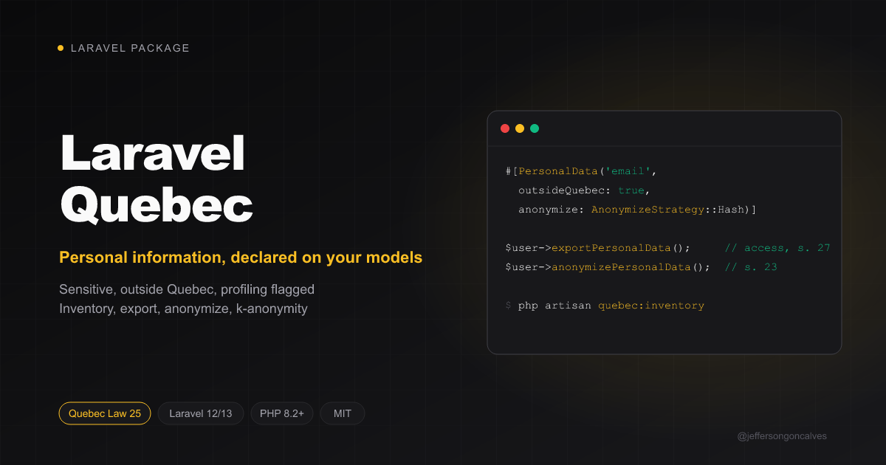

# Laravel Quebec



[](https://packagist.org/packages/jeffersongoncalves/laravel-quebec)
[](https://github.com/jeffersongoncalves/laravel-quebec/actions/workflows/tests.yml)
[](https://packagist.org/packages/jeffersongoncalves/laravel-quebec)

Core of a Laravel toolkit for Quebec's *Act respecting the protection of personal information in the private sector* (CQLR c. P-39.1), as amended by Law 25 (Bill 64). You declare which columns of your Eloquent models hold personal information. With those declarations the package can:

- build the **personal information inventory**: what you hold, for which purpose, which information is sensitive (s. 12), which is communicated outside Quebec (a privacy impact assessment first, s. 17) and which is collected with technology that identifies, locates or profiles the person (s. 8.1);
- **export** a person's information, also in a structured, commonly used technological format (access and portability, s. 27);
- **destroy or anonymize** a record once its purposes are achieved, choosing a strategy per column (s. 23).

Quebec's law is the strictest in Canada; following it covers most of what the federal PIPEDA asks of businesses in the other provinces.

> This package gives you tooling. It does not make you compliant on its own. Note that the Act distinguishes de-identified information (s. 12) from anonymized information (s. 23, irreversible, under the regulation's criteria): hashing and masking de-identify; only nullifying everything that identifies the person anonymizes.

## Installation

```bash
composer require jeffersongoncalves/laravel-quebec
php artisan vendor:publish --tag="quebec-config"
```

## Declaring personal information

```php
use JeffersonGoncalves\Quebec\Attributes\PersonalData;
use JeffersonGoncalves\Quebec\Concerns\InteractsWithPersonalData;
use JeffersonGoncalves\Quebec\Contracts\HasPersonalData;
use JeffersonGoncalves\Quebec\Enums\{AnonymizeStrategy, DataCategory};

#[PersonalData('name', purpose: 'Account identification', anonymize: AnonymizeStrategy::Mask)]
#[PersonalData('email', retention: '5 years', anonymize: AnonymizeStrategy::Hash, outsideQuebec: true)]
#[PersonalData('health_notes', category: DataCategory::Sensitive)]
#[PersonalData('location', profiling: true)]
class User extends Authenticatable implements HasPersonalData
{
    use InteractsWithPersonalData;
}
```

- `category: DataCategory::Sensitive`: information that, due to its medical, biometric or otherwise intimate nature, or the context of its use, entails a high level of reasonable expectation of privacy. Using it for another purpose needs express consent.
- `outsideQuebec`: communicated outside Quebec (a cloud provider elsewhere, for example). The Act requires a privacy impact assessment first and a written agreement.
- `profiling`: collected with technology that identifies, locates or profiles the person. You must tell them, and how to activate those functions (they are off by default).

Register the model in `config/quebec.php`:

```php
'models' => [
    App\Models\User::class,
],
```

### Strategies

| Strategy | Result |
|---|---|
| `Nullify` (default) | `null` |
| `Hash` | HMAC-SHA256 keyed by `QUEBEC_HASH_KEY` (falls back to `APP_KEY`): a stable pseudonym (de-identified, not anonymized) |
| `Mask` | `Marie Tremblay` → `M*************` |
| `Keep` | untouched, for information you must keep under another law |

Encrypted casts (`'encrypted'`) work as expected: the value is decrypted, then transformed, then encrypted again.

## Usage

```php
use JeffersonGoncalves\Quebec\Facades\Quebec;

Quebec::inventory();               // one row per declared column, with outside_quebec and profiling
$user->exportPersonalData();       // ['name' => ..., 'email' => ..., ...]
$user->anonymizePersonalData();    // applies each strategy and saves
```

`anonymizePersonalData()` fires `JeffersonGoncalves\Quebec\Events\PersonalDataAnonymized` with the model and the columns it changed.

```bash
php artisan quebec:inventory          # table
php artisan quebec:inventory --json   # machine readable
```

## k-anonymity

Before you publish or share a dataset as anonymized, check that nobody can be singled out by combining quasi-identifiers such as postal code, birth date and gender. A dataset is *k*-anonymous when every combination of those values is shared by at least *k* rows; *l*-diverse when each group also holds at least *l* distinct sensitive values.

```php
use JeffersonGoncalves\Quebec\Generalize;

Quebec::kAnonymity(Patient::class, [
    'postal_code' => Generalize::prefix(3),  // H2X 1Y4 → H2X
    'birth_date' => Generalize::date('Y'),
    'gender',
], k: 5, sensitive: 'diagnosis');
```

```bash
php artisan quebec:k-anonymity "App\Models\Patient" postal_code birth_date --k=5 --sensitive=diagnosis
```

The command fails (exit code 1) when the data is below the target *k*.

## Upgrading to 2.0

2.0 runs on [laravel-privacy](https://github.com/jeffersongoncalves/laravel-privacy), the engine shared by the
LGPD, GDPR, CCPA, US privacy and Quebec suites. The classes, config keys, tables, commands and events of this package
keep their names: your code, config and data need no change. Suites installed side by side never see each other's
events. If you extend a class of this package, it now inherits from its `JeffersonGoncalves\Privacy` base.

## Testing

```bash
composer test
```

## Changelog

See [CHANGELOG](CHANGELOG.md).

## License

The MIT License (MIT). See [License File](LICENSE.md).
